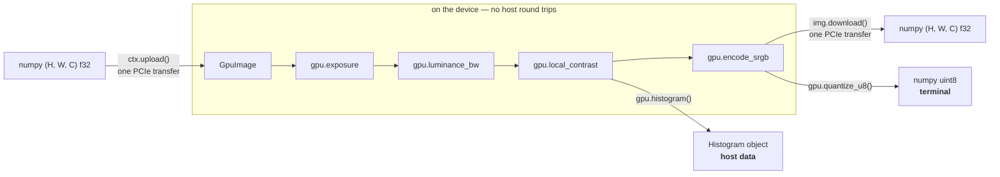
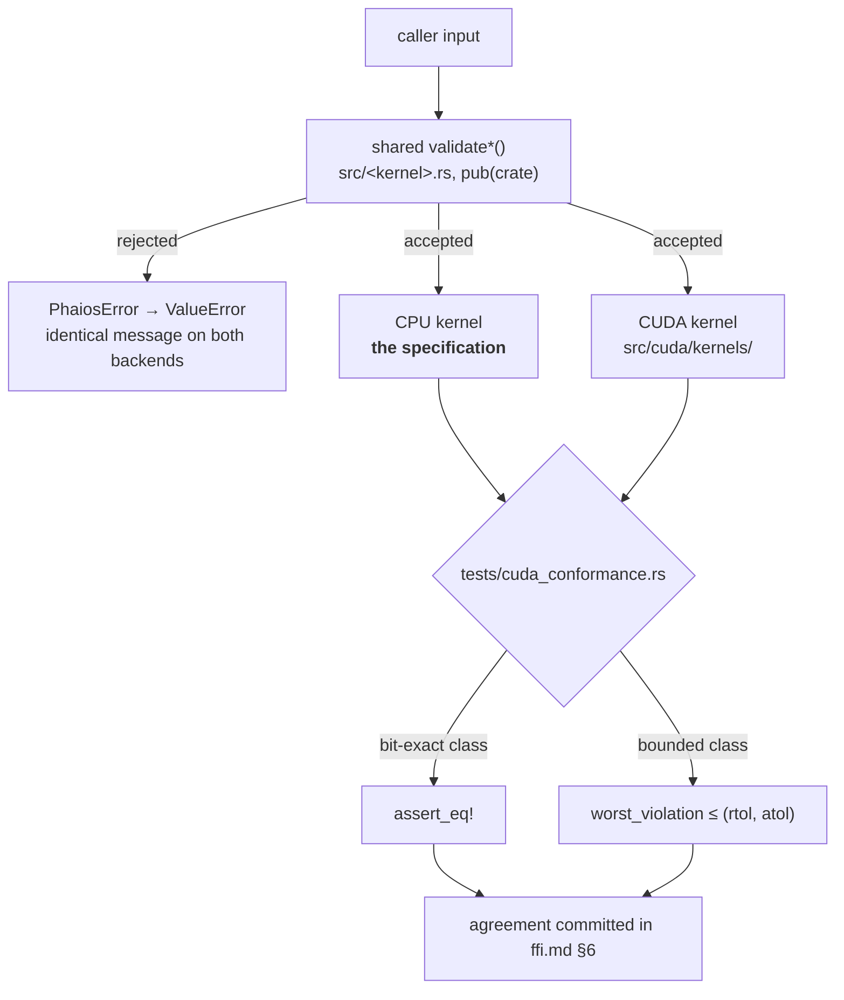

# The CUDA backend

An optional, strictly additive second surface. Everything the CPU
backend does, on an NVIDIA device, through a device-resident API that
keeps a frame on the card across a whole chain of kernels.

It is not a drop-in replacement. The CPU implementation is the
specification: every GPU kernel is validated against it, never the
other way round, and a disagreement beyond the committed bound means
the GPU kernel is wrong.

## What it is

All 27 kernels have a GPU twin. There is no CPU-only kernel. They are
built from 21 `.cu` files carrying 36 `__global__` entry points;
`sharpen` and `glow` reuse the shared `blur_device` rather than
carrying a blur of their own.

| | |
|---|---|
| Interface | [cudarc](https://crates.io/crates/cudarc), CUDA driver API only |
| Device code | `src/cuda/ptx/*.cu`, compiled to PTX by `nvcc` at build time |
| PTX target | `compute_80`, each file compiled strict, FMA or fast math ([precision modes](#precision-modes)) |
| Minimum device | compute capability **8.0** (Ampere), `MIN_COMPUTE_CAPABILITY` in `src/cuda/context.rs` |
| Cargo feature | `cuda`, off by default |
| Driver | `libcuda.so.1`, opened at run time, not linked |

The PTX is JIT-compiled forward by the driver, so one build covers the
RTX 30, 40 and 50 series and the A and H series. A device below
compute capability 8.0 is enumerated but reported unsupported.

Because the driver is dlopened rather than linked, a binary built with
`--features cuda` still runs on a machine with no NVIDIA driver at all.
It reports no devices instead of failing to load:

| Call | With no driver or no device |
|---|---|
| `gpu.available()` | `False` |
| `gpu.devices()` | `[]` |
| `gpu.GpuContext(0)` | `RuntimeError` |

Every example gated behind the feature prints why it is skipping and
exits 0 on such a machine.

## Build and run

Python:

```sh
source .phaios-venv/bin/activate
maturin develop --release --features cuda
```

Omitting `--features cuda` silently produces a CPU-only module:
`from phaios_core import gpu` then fails with `ImportError`, and the
build gives no warning. This is the single most common mistake.

Rust:

```sh
export CUDA_CACHE_PATH="${CUDA_CACHE_PATH:-$PWD/.cache/cuda-jit}"
cargo build --features cuda
cargo test --features cuda
cargo run --release --example 22_gpu_pipeline --features cuda
```

The driver JIT-compiles the PTX for the device on first use and caches
the result, in `~/.nv/ComputeCache` unless `CUDA_CACHE_PATH` names
another directory. The first line, run from the repository root, keeps
that cache in the repository's gitignored `.cache/`, as
`scripts/gpu-verify.sh` does, and leaves a setting of your own alone.

`cargo test` and `cargo clippy` skip the CUDA backend entirely without
`--features cuda`: it sits behind `#[cfg]`, so even a type error there
passes. Run `./scripts/gpu-verify.sh` for what hosted CI cannot.

Build requirements: `nvcc` on `PATH` or under `$CUDA_PATH/bin` (the
build script also tries the Arch default location), and a driver new
enough for `cuMemAllocAsync`, which is CUDA 11.2.

## The device-resident chain

Upload once, run the chain on the device, download once. A chain of n
kernels written as n per-call offloads pays n PCIe round trips to
compute a result that needed two crossings.



```python
from phaios_core import gpu, GuidedFilterParams

ctx = gpu.GpuContext(0)
img = ctx.upload(array)                    # one transfer up
img = gpu.exposure(img, 0.5)
img = gpu.luminance_bw(img)
img = gpu.local_contrast(img, GuidedFilterParams(8, 0.01), 0.6)
img = gpu.encode_srgb(img)
out = img.download()                       # one transfer down
```

Three kernels end the chain because they return host data by contract:

| Kernel | Returns |
|---|---|
| `gpu.quantize_u8` | `numpy.uint8` array |
| `gpu.quantize_u16` | `numpy.uint16` array |
| `gpu.histogram` | a `Histogram` object |

There is nothing further a quantised buffer or a bin count can do on
the device, so they cross the bus rather than staying resident.

Transfers are not free, and they are the reason offload is a pipeline
decision rather than a per-call one. A 24 MP three-channel frame is
285 MiB; at roughly 8 GB/s an upload costs tens of milliseconds, more
than the whole device-side chain it feeds. Offload pays when the frame
stays resident. It does not pay per call.

Each `img = gpu.f(img)` drops the previous buffer as soon as the next
exists, so a chain of eleven kernels holds two images on the device, not
eleven. `examples/22_gpu_pipeline.rs` measures all of this.

## How the backends are kept in agreement

Validation is extracted into a shared `pub(crate) validate*` in each
kernel's module, so both backends reject identical inputs with
identical messages. Past that gate, the CPU kernel is the oracle and
`tests/cuda_conformance.rs` compares the device against it.



The predicate, stated once: a comparison passes when the worst value of
`|x − y| / (atol + rtol·|x|)` over the whole array is at most 1.0.

### Agreement classes

Four classes, and every one of the 27 kernels falls into one of them.
The reasoning behind each is in
[architecture.md](architecture.md); the normative statement is
[ffi.md §6](ffi.md#6-determinism).

| Class | Bound | Kernels |
|---|---|---|
| bit-exact | `==`, NaN payload and sign aside | `exposure`, `luminance_bw`, `channel_mixer_bw`, `color_filter_bw`, `vignette`, `tone_curve` at `power == 1` (no subnormal input or result), `crop`, `orient`, `resize`, `straighten`, `hot_pixels`, `shadow_rolloff`, `highlight_rolloff`, `apply_lut`, `histogram`, `quantize_u8`, `quantize_u16`, `film_grain`'s integer hash, every identity fast path |
| one transcendental | rtol 1e-5, atol 1e-7 | `encode_srgb`, `tone_curve` at `power != 1`, `split_toning`, `hsl_bw`, `zone_system`, `blur`, `glow`, `sharpen` |
| guided filter | rtol 1e-4, atol 1e-6 | `local_contrast`, `denoise` (both `C == 1` and `C == 3`) |
| Box–Muller | rtol 1e-3, atol 1e-5 | `film_grain`'s Box–Muller half |

Bit-exactness is achievable where every operation is correctly rounded
on both sides: Rust does not contract `a*b+c` into a fused multiply-add,
the strict files tell the device the same (`-fmad=false`) and keep
division and square root IEEE, and `tone_curve`, compiled with fast
math, pins its affine step to the CPU's two roundings in the source.
Strict and free of transcendentals is not enough on its own: `blur`,
`glow` and `sharpen` are both, yet bounded, because the device
reformulates the algorithm. The bit-exact row is the list in
[ffi.md §6](ffi.md#6-determinism), not a rule. The other kernels are
bounded for one of three reasons. IEEE-754 standardises no
transcendental at all: two CPUs with different libms already disagree
in the low bits, and CUDA adds one more math library to that list. The
device reformulates `blur`'s and `local_contrast`'s sums. And the
kernels compiled with FMA or fast math give up exactness on purpose,
for speed (below).

### Precision modes

`build.rs` compiles each `.cu` file in one of three modes (`PRECISION`).
A file leaves strict only for a gain above run-to-run noise worth more
than about 0.04 ms at 24 MP, at a cost of at most one 8-bit code against
the CPU and an error that stays within a fixed (rtol, atol) bound.
Changes are each mode's time against strict, measured on whole builds
compiled in each mode (2026-11-11, the machine below).

| Mode | nvcc flags | Files | Gain |
|---|---|---|---|
| fast math | `--use_fast_math`: FMA contraction, approximate division, square root and `ex2`/`lg2`, subnormal inputs and results flushed to zero | `zone_system`, `hsl_bw`, `encode_srgb`, `tone_curve` | −47 %, −21 %, −14 %, −13 % |
| FMA | `-fmad=true`, IEEE otherwise | `local_contrast`, `denoise` | −12 % (`C == 1` denoise runs on `local_contrast`'s kernels), −5 % at `C == 3` |
| strict | `-fmad=false -ftz=false -prec-div=true -prec-sqrt=true` | the other 15 files | — |

Fast math reaches only `tone_curve`'s `powf` path: its affine step is
pinned to the CPU's two roundings (`__fmul_rn`, `__fadd_rn`, which fast
math never contracts). Fused into one FMA, the step kept a residue
where the CPU cancels to exactly 0, and `powf` at power < 1 lifted it
by up to 8 codes at 8 bits.

Two more files pin a few operations the same way. `hsl_bw` computes its
three hue quotients and its chroma ratio correctly rounded
(`__fdiv_rn`): approximated, they missed the bound by 2.1× under
opposing hue weights, and differed by the full range next to
`FLT_MAX`, −1e30 or −inf. `denoise` pins `var(I)`, `cov(I, p_c)` and the
intercept `b_c` in `coeff_ab_cross` (`__dmul_rn`, `__dsub_rn`): fused,
the intercept kept a product's rounding residue and missed the bound by
up to 4e24× beside a sample above about 1e12. Their −21 % and −5 % are
measured with the pins, in interleaved runs on 2026-11-12; the pins
cost 6.6 % and 2.0 % of the kernel.

Strict where the other modes lose or do not pay for their error:
`vignette` gains 23 % (0.1 ms) under fast math, but its error grows with
input × amount / feather, so no fixed bound held; `blur`'s direct path
is 20 % slower under either; `sharpen` and `glow` spend their time in
`blur`; `film_grain` gains 0.06 ms for about 45 times the CPU
difference; `geometry`, `histogram`, `highlight_rolloff`, `lut` and
`shadow_rolloff` gain 1–4 %, at most 0.035 ms; the rest is within noise.

With the modes mixed as above, a typical pipeline (exposure, hsl_bw,
zone_system, local_contrast, film_grain, split_toning, vignette,
tone_curve, encode_srgb, quantize) takes 18.2 ms on the GPU at 24 MP,
against 21.2 ms all strict: about 2.6 ms, or 12 % once the 2 % drift
measured between sessions on the unchanged kernels is set aside. Its
accuracy was measured on a longer chain (exposure, hsl_bw, zone_system,
local_contrast, shadow_rolloff, tone_curve, film_grain, split_toning,
vignette, highlight_rolloff, encode_srgb, quantize) over the synthetic
test images and the five test photographs
(`tools/kernel-viewer/testdata/`): within one 8-bit code of the CPU
everywhere, and at 16 bits up to 14 codes on isolated near-black pixels,
mostly on the two darkest photographs.

Per-kernel bounds are also printed by
[`examples/23_gpu_selftest.rs`](../examples/23_gpu_selftest.rs), which
runs every kernel on both backends and prints the measured violation as
a fraction of its bound.

### GPU-specific limits

| Kernel | Limit |
|---|---|
| `denoise` | `radius` capped at `MAX_RADIUS = 32` on **both** backends. The device sums each window directly from its own `(2r+1)²` pixels, so cost is linear in the radius and no larger case is ever asserted |
| `blur`, `glow`, `sharpen` | below σ = 6 the device convolves directly, accumulating in Kahan-compensated f32; at or above σ = 6 both backends use f64 box passes |
| `local_contrast` | the device replaces the CPU's global f64 summed-area tables with separable box passes. That and its file's FMA contraction are why its class is 1e-4 / 1e-6 |
| `histogram` | the bin accumulator is bounded at 256 MiB, which on a multi-channel image binds before `MAX_BINS` does |

On non-finite input the backends may disagree without bound; see
[ffi.md §1](ffi.md#1-array-layout). That is a precondition, not a
validated input.

## The backend fingerprint

```
cuda/<device name>/cc<major>.<minor>/ptx-compute_80/nvcc-<major>.<minor>.<patch>
```

`GpuContext.fingerprint` returns it, and `GpuImage.fingerprint` returns
the fingerprint of the context the image belongs to. On this machine:

```
cuda/NVIDIA GeForce RTX 5070 Ti/cc12.0/ptx-compute_80/nvcc-13.4.92
```

The `nvcc-` segment is load-bearing. The PTX is not committed: it is
regenerated at build time by whatever toolkit is present, and the
bounded kernels inline toolkit code (libdevice `cbrtf` in `split_toning`
and `logf`/`cosf` in `film_grain`, nvcc's fast-math intrinsics) that
changes between toolkits. Two builds of the same commit under different
toolkits are therefore two different backends. Until the segment
existed they reported the same key, and this project moved from toolkit
13.3 to 13.4 with the fingerprint unchanged. The bit-exact kernels use
IEEE operations only and agree across toolkits either way.

The fingerprint does not name the driver. In the FMA and fast-math
files, and wherever approximate instructions remain (libdevice `cbrtf`
in `split_toning`), the driver's JIT compiler finishes part of the
arithmetic (it may fuse a multiply with an add, and it lowers the
approximate instructions), so a driver update can move their last bits
under an unchanged fingerprint. At 8 bits that is expected to stay
within about one code; it has not been measured across drivers.

A consumer that promises exact reproduction from a settings file must
either record the fingerprint alongside the parameters, or designate
`cpu` as the archival backend and use CUDA for interactive work.

## Determinism

Within one backend and driver, two calls with the same input,
parameters and seed produce bit-identical output: in the same process,
in another process, on another machine with the same fingerprint and
driver, at any thread count, block size or launch geometry. Randomness
is never global and never implicit: `film_grain` and the quantiser
dither hash the pixel's own coordinates together with an explicit
`seed`, so no pixel depends on another's state and nothing depends on
the order the device schedules its blocks.

Across backends the difference is bounded by the table above, and that
bound is asserted by the conformance suite rather than assumed. A
driver or toolkit update that regresses accuracy fails the suite.

## Performance

Measured on the machine below. These are informational figures, not CI
gates.

### Test conditions

```
Measured    2026-11-12
Image       4323 × 5765 f32 (24 MP), deterministic pseudo-random fill
GPU         NVIDIA GeForce RTX 5070 Ti, cc 12.0, driver 620.70.06
CPU         AMD Ryzen 9 9950X 16-Core, 32 threads, rayon default pool
Host        Linux 7.2.15-zen1-1-zen
nvcc        release 13.4, V13.4.92
rustc       1.99.1 (58cf8f9c3 2026-10-13)
Fingerprint cuda/NVIDIA GeForce RTX 5070 Ti/cc12.0/ptx-compute_80/nvcc-13.4.92
Precision   per file, build.rs PRECISION (see "Precision modes")
Command     cargo bench --bench kernels
            cargo bench --bench gpu --features cuda
Statistic   criterion median of 100 samples
Timing      device-resident, PCIe excluded, drained by a 1×1×1 download;
            quantize and histogram include their mandatory readback
```

Both columns come from one session under one fingerprint. Run-to-run
spread on this machine reaches tens of percent for the cheaper kernels,
so compare within a table and not across two of them.

The GPU figures exclude the upload and the download, because that is
what a resident chain pays. A single kernel called through the per-call
offload form pays both transfers and will not show these ratios; see
`examples/22_gpu_pipeline.rs` for the measured difference between the
two shapes.

### Per-kernel medians

| Kernel | CPU | GPU | Speed-up | C | Benchmark id |
|---|---|---|---|---|---|
| `orient` | 140.5 ms | 1.90 ms | 74x | 3 | `orient/24MP/rotate90` |
| `hot_pixels` | 19.1 ms | 0.45 ms | 42x | 1 | `hot_pixels/24MP/1ch` |
| `denoise` | 138.8 ms | 7.19 ms | 19x | 1 | `denoise/24MP/1ch-r4` |
| `denoise` | 697.7 ms | 37.25 ms | 19x | 3 | `denoise/24MP/3ch-r4` |
| `straighten` | 52.8 ms | 2.26 ms | 23x | 3 | `straighten/24MP/2deg` |
| `crop` | 9.2 ms | 0.27 ms | 34x | 3 | `crop/24MP/centre-half` |
| `resize` | 30.5 ms | 1.45 ms | 21x | 3 | `resize/24MP/to-2048-area` |
| `exposure` | 27.0 ms | 0.88 ms | 31x | 3 | `exposure/24MP/+1EV` |
| `luminance_bw` | 12.6 ms | 0.49 ms | 25x | 3 → 1 | `luminance_bw/24MP/BT709` |
| `channel_mixer_bw` | 12.6 ms | 0.49 ms | 26x | 3 → 1 | `channel_mixer_bw/24MP` |
| `color_filter_bw` | 12.6 ms | 0.49 ms | 25x | 3 → 1 | `color_filter_bw/24MP/Red25A` |
| `hsl_bw` | 49.9 ms | 0.53 ms | 94x | 3 → 1 | `hsl_bw/24MP/8-bands` |
| `zone_system` | 14.4 ms | 0.35 ms | 42x | 1 | `zone_system/24MP/1-zone-offset` |
| `blur` | 36.9 ms | 4.22 ms | 9x | 1 | `blur/24MP/sigma2-direct` |
| `blur` | 57.1 ms | not covered | — | 1 | `blur/24MP/sigma4-direct` |
| `blur` | 78.0 ms | not covered | — | 1 | `blur/24MP/sigma5.9-direct` |
| `blur` | 70.7 ms | not covered | — | 1 | `blur/24MP/sigma6-box` |
| `blur` | 70.9 ms | 7.91 ms | 9x | 1 | `blur/24MP/sigma16-box` |
| `blur` | 70.6 ms | 8.53 ms | 8x | 1 | `blur/24MP/sigma64-box` |
| `glow` | 92.1 ms | 8.53 ms | 11x | 1 | `glow/24MP/halation` |
| `glow` | 91.8 ms | not covered | — | 1 | `glow/24MP/diffusion` |
| `glow` | 92.0 ms | not covered | — | 1 | `glow/24MP/glare` |
| `local_contrast` | 162.5 ms | 10.50 ms | 15x | 1 | `local_contrast/24MP/r=8` |
| `sharpen` | 42.6 ms | 4.08 ms | 10x | 1 | `sharpen/24MP/capture` |
| `shadow_rolloff` | 8.7 ms | 0.31 ms | 29x | 1 | `shadow_rolloff/24MP/knee0.2-strength0.8` |
| `tone_curve` | 9.0 ms | 0.30 ms | 30x | 1 | `tone_curve/24MP/slope-offset-power` |
| `film_grain` | 58.3 ms | 1.17 ms | 50x | 1 | `film_grain/24MP/size=2` |
| `split_toning` | 27.7 ms | 0.56 ms | 49x | 1 → 3 | `split_toning/24MP` |
| `vignette` | 10.1 ms | 0.42 ms | 24x | 1 | `vignette/24MP` |
| `highlight_rolloff` | 8.7 ms | 0.32 ms | 27x | 1 | `highlight_rolloff/24MP/knee0.7-white4` |
| `highlight_rolloff` | 8.7 ms | not covered | — | 1 | `highlight_rolloff/24MP/default-clip` |
| `encode_srgb` | 9.0 ms | 0.30 ms | 30x | 1 | `encode_srgb/24MP` |
| `apply_lut` | 8.8 ms | 0.32 ms | 28x | 1 | `apply_lut/24MP/256-entry` |
| `histogram` | 3.9 ms | not covered | — | 1 | `histogram/24MP/256bins-grey` |
| `histogram` | 9.7 ms | 0.47 ms | 21x | 3 | `histogram/24MP/256bins-rgb` |
| `histogram` | 6.3 ms | not covered | — | 1 | `histogram/24MP/65536bins-grey` |
| `quantize` | 5.7 ms | 3.11 ms | 2x | 1 | `quantize/24MP/u8-plain` |
| `quantize` | 9.9 ms | not covered | — | 1 | `quantize/24MP/u8-dithered` |
| `quantize` | 11.1 ms | not covered | — | 1 | `quantize/24MP/u16-dithered` |

The `hsl_bw` and `C = 3` `denoise` GPU rows were measured before those
files pinned a few operations (2026-11-13, "Precision modes"). In
interleaved runs the pins cost 6.6 % and 2.0 %, which puts them at
about 0.56 ms and 37.9 ms.

`C` is the channel count the benchmark runs. Rows marked "not covered"
have no counterpart in `benches/gpu.rs`: the GPU suite runs one case per
cost path rather than every CPU case. `quantize_u16` has no GPU row at
all; `gpu.quantize_u16` exists and is covered by the conformance suite,
not by a benchmark.

Reading the table:

- The three B&W collapses cost the same on both backends, to two
  decimal places. They read three channels and write one, and nothing
  in any of them is expensive enough to matter beside that traffic.
- `quantize` is the one row where the ratio is small, and it is not a
  slow kernel. It is the only one whose time includes a mandatory
  readback: 24.9 MB of codes cross the bus on every call, and that
  transfer is most of the 3.11 ms. A terminal kernel cannot avoid it.
- `hsl_bw` and `orient` show the largest ratios for opposite reasons.
  `hsl_bw` is arithmetic-heavy, eight `exp` per pixel, which is what a
  GPU is for. `orient/rotate90` is cache-hostile and single-threaded on
  the CPU, so the ratio measures a known-slow CPU kernel as much as a
  fast device one.
- `denoise` at three channels is the most expensive kernel in the crate
  on either backend. Its cost is linear in the radius, which is why
  `radius` is capped at 32.
- The whole CPU chain that `examples/22_gpu_pipeline.rs` runs, eleven
  stages at 24 MP, measures about 416 ms against 56 ms for the
  device-resident form, upload and download included. That is 7.4x, not
  the 20x an individual row suggests, because the resident chain still
  pays two PCIe crossings and the cheap kernels are bus-bound on both
  sides.

## Verifying on your GPU

```sh
./scripts/gpu-verify.sh              # full run
./scripts/gpu-verify.sh --quick      # examples in the dev profile, no release build
```

It first exports
`CUDA_CACHE_PATH="${CUDA_CACHE_PATH:-$PWD/.cache/cuda-jit}"`, from the
repository root, so the driver's JIT cache goes to `.cache/cuda-jit`
rather than `~/.nv/ComputeCache`; a `CUDA_CACHE_PATH` already set in
your environment is kept. Then it runs, in order:

1. an environment probe: the `nvcc` that `build.rs` compiles with
   (`$CUDA_PATH/bin`, then `PATH`, then `/opt/cuda/bin`) and its full
   release (`13.4.92`, not `13.4`), `nvidia-smi`, `rustc --version`,
   the crate version;
2. `cargo fmt --check`;
3. `cargo clippy --all-targets --features cuda -- -D warnings`;
4. `PHAIOS_REQUIRE_GPU=1 cargo test --features cuda`: the environment
   variable turns the conformance suite's device-missing skip into a
   hard failure, so a green run cannot mean "quietly skipped the CUDA
   tests";
5. a PTX audit of the build step 4 tested, the `OUT_DIR` of
   `cargo build --features cuda`. It fails if any `.ptx` there names in
   its header a different release than the `nvcc` step 1 found. Step 6
   checks the build the examples run, which in a full run is the release
   build, so this is what catches a stale dev build beside a fresh
   release build: for example a release build first made, or cleaned,
   after a toolkit change cargo could not see. The rest it prints
   without judging: the toolkit named in the PTX headers, then for each
   `.ptx` its mode in `build.rs`'s `PRECISION` table and how many of its
   instructions are fused multiply-adds (`fma.*`), approximate
   (`.approx`), flush-to-zero (`.ftz`), and float add, subtract or
   multiply with no rounding modifier, the form the driver's JIT may
   fuse. `precision_tests` in `src/cuda/kernels/mod.rs`, run in step 4,
   already asserts each mode's signature; the counts are printed so that
   a report from another machine or toolkit shows them;
6. every example with `required-features = ["cuda"]`, discovered from
   `cargo metadata` rather than listed. Each one's output is also kept
   in `.cache/gpu-verify/<example>.log`, and the backend fingerprint
   the examples print is read back from there. The run fails if they
   print different fingerprints, or if the fingerprint's `nvcc-`
   segment is not the release step 1 found;
7. the Python bindings, if `.phaios-venv` exists. If `phaios_core` is
   not installed in it, the step is skipped. If it is installed but
   fails to import, the run fails: that is a broken build, not a
   CPU-only one. If it imports but has no `gpu` submodule, a CPU-only
   build, the step is skipped. Otherwise the wheel's
   `GpuContext(0).fingerprint` is compared with the one from step 6,
   then `pytest tests/ffi_gpu.py -q` and `mypy.stubtest` run. A
   different fingerprint fails the run, because the venv then holds a
   build from another toolkit and the tests would exercise that build
   instead. A wheel built from older sources by the same toolkit has the
   same fingerprint, and this check does not catch it. Each skip or
   failure here names the build command, `maturin develop --release
   --features cuda`;
8. the summary block.

When step 5 or 6 finds PTX from another toolkit, cargo did not re-run
`build.rs` after the toolkit changed (`watch_toolkit` in `build.rs`
lists when that happens). `touch src/cuda/ptx` fixes it: `build.rs`
watches that directory, so the next build in every profile and target
directory, maturin's included, re-runs it and rebuilds the PTX.

Step 7 is skipped when there is no `.phaios-venv`, when `phaios_core`
is not installed in it, or when the installed build has no `gpu`
submodule. The run still exits 0, but the summary's `python` line names
the skip and its `result` line does not claim that every check passed.
With `PHAIOS_REQUIRE_GPU` set in the environment the script is run
from, to any value (the Rust tests read it the same way), every skip is
a failure instead:

```sh
PHAIOS_REQUIRE_GPU=1 ./scripts/gpu-verify.sh
```

It does not run benchmarks. It exits non-zero on the first failure, and
unlike the examples it treats a missing device as an error rather than
skipping politely.

`.github/workflows/gpu.yml` invokes the same script on a self-hosted
runner, so the hand-run command and the CI job cannot drift. That job
creates no `.phaios-venv`, so step 7 is skipped there.

The block it prints last is the one to share:

```
phaios-core   0.2.0-dev
device        NVIDIA GeForce RTX 5070 Ti, 620.70.06
fingerprint   cuda/NVIDIA GeForce RTX 5070 Ti/cc12.0/ptx-compute_80/nvcc-13.4.92
nvcc          13.4.92
jit cache     .cache/cuda-jit
rustc         1.99.1
host          Linux 7.2.15-zen1-1-zen x86_64
run           full
python        passed (tests/ffi_gpu.py, stubtest; wheel fingerprint matches)
result        all GPU checks passed
```

Its `jit cache` line is the `CUDA_CACHE_PATH` the run used, relative to
the repository root when it lies inside it.

With step 7 skipped, its last two lines read, for example:

```
python        skipped: no .phaios-venv
result        GPU checks passed except the Python step, which was skipped
```

## Confirmed on other GPUs

**No hosted CI runs the GPU suite.** GitHub's runners have neither
`nvcc` nor an NVIDIA device, so `.github/workflows/ci.yml` skips every
target behind `required-features = ["cuda"]`. The only evidence this
backend works on a given card is that someone ran it there.

| phaios-core | device | driver | nvcc | rustc | host | date | result |
|---|---|---|---|---|---|---|---|
| 0.2.0-dev | NVIDIA GeForce RTX 5070 Ti (cc 12.0) | 615.71.09 | 13.4.59 | 1.98.1 | Linux 7.2.6-zen2-1-zen x86_64 | 2026-09-16 | all GPU checks passed |
| 0.2.0-dev | NVIDIA GeForce RTX 5070 Ti (cc 12.0) | 620.70.06 | 13.4.92 | 1.99.1 | Linux 7.2.15-zen1-1-zen x86_64 | 2026-11-11 | all GPU checks passed |

To add a row: run `PHAIOS_REQUIRE_GPU=1 ./scripts/gpu-verify.sh` and
open an issue titled `GPU report: <device>` containing the block it
printed. The table grows by contribution, and a card, driver or toolkit
this project has no access to is worth more than another run on the one
it has.

Compute capability 8.0 is the floor. The PTX targets `compute_80` and
the driver JIT-compiles it forward, so a single build covers every
supported device without a fat binary.
